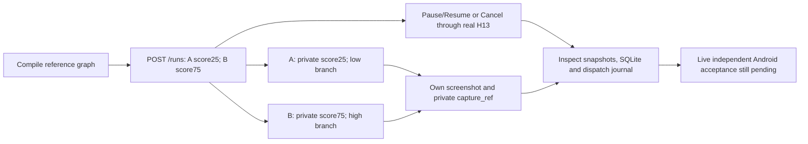

# H15 — Combined multi-device acceptance

## Overview

This pack checks the implemented multi-device engine through the actual Runtime,
authenticated HTTP and migrated SQLite. It reuses the H14 owner/process fixture.
The automated commands use controlled ADB endpoints, never your emulator or your
normal Runtime database. Independent Android and native Windows evidence remain
separate required gates; H6–H8 Wait Variable remains deferred.



## Run from the Runtime repository

Requires Go, Python 3 and Linux process/loopback support. No Python packages,
real ADB or emulators are needed for this controlled check.

```bash
make build
python3 cmd/agent/testdata/h15_acceptance.py bin/a2matex-runtime --results-dir test_demo/h15-results
```

Choose a new or empty results directory. The runner refuses to erase existing
data. It starts/stops its own Runtime processes, allocates isolated storage and
uses a trusted synthetic ADB executable. Session credentials stay in memory;
requests/results contain synthetic serials only. The complete run takes roughly
15 seconds on the development host, mostly the two deliberate five-second Delays;
this is an observation, not a performance guarantee.

For one scenario:

```bash
python3 cmd/agent/testdata/h15_acceptance.py bin/a2matex-runtime --scenario reference --results-dir test_demo/h15-reference
```

| Scenario | Observable pass condition |
| --- | --- |
| `reference` | Both Home processes enter before release; A takes low, B high; exactly 20 successful attempts, four actions and two correctly owned PNGs. Replay changes nothing. |
| `private-output` | Same reference plus a real Switch comparing each Flow `capture_ref` to that device's Screenshot output; neither enters `wrong_output`. |
| `rejection` | Empty/duplicate/malformed selection returns 400; missing target/invalid input returns 422. Every case creates zero execution/event rows and dispatches no action. Missing bearer is 401. |
| `pause-resume` | Both real `hold` attempts entered before Pause; pending opposite Resume is 409. Confirmed PAUSED retains five successful attempts/member, `choose` next and no running attempt. Duplicate Pause is 200 and changes no event/history. Resume completes the original 20-attempt run. |
| `cancel-active` | Cancel during both Delays retains the first four successful attempts/member and cancels each fifth attempt; no capture. Fresh same-process reference run succeeds. |
| `cancel-paused` | Cancel after both have parked preserves all five successful attempts/member; no fabricated cancellation attempt or capture. Fresh run succeeds. |
| `global-and-fresh-scopes` | Only A writes `shared_score=37`; B's Home stays gated until A has published and completed successors. B's real Global Switch matches 37 without writing it. New groups reading old Global/Flow names fail at consumption; initialized fresh reference succeeds. |
| `disconnect` | Both admit READY and enter Delay. A disappears before its failing Home; diagnostic discovery proves loss. While B is gated, group stays RUNNING with failed=1/running=1 and A `DEVICE_DISCONNECTED`. B completes, group FAILED, and reconnect/replay adds no action. |

The derived variants are built from the one tracked reference graph. Each exact
compiled variant and submitted request is saved in its scenario directory.
No debug endpoint, fake Set Variable, persistent variable table or node handler
replacement is introduced.

## Read the output

Open `report.json` for build/fixture fingerprints, versions, scenario outcomes
and explicit pending platform gates. Each scenario contains:

- `compile-<group>.json` and `request-<group>.json`: inspectable graph/input-schema
  and actual admission body, without bearer credentials.
- `snapshot-<group>.json` and `records-<group>.json`: final HTTP projection and
  named-column SQLite records. Controls also save `paused-records.json`;
  disconnect saves its stable intermediate snapshot.
- `<group>-device-0.png` and `<group>-device-1.png`: authenticated downloads from
  reference/private/control-resumed/fresh reference captures. Both may have the
  same pixels; their artifact and attempt identities must differ.
- `dispatch.jsonl`: one `entered` row per Home/Screenshot dispatch, including
  serial/operation/PID. Discovery, readiness and version probes are excluded.
- `agent-1.log` and `a2matex/runtime/execution.sqlite3`: actual isolated Runtime
  logs and durable database. The normal application database is untouched.

In DataGrip, open that scenario's SQLite file. After the runner exits it is safe
to inspect; use read-only mode. For the reference case these queries show one
SUCCEEDED group, two SUCCEEDED members, 10 attempts each and two artifacts:

```sql
SELECT id, request_id, status FROM run_groups;
SELECT id, admission_ordinal, adb_serial, status, next_node_id
FROM device_executions ORDER BY admission_ordinal;
SELECT d.adb_serial, a.sequence, a.node_id, a.attempt_number, a.status,
       a.output_json, a.error_json
FROM node_attempts a JOIN device_executions d ON d.id = a.device_execution_id
ORDER BY d.admission_ordinal, a.sequence;
SELECT f.id, d.adb_serial, a.id AS attempt_id, f.width, f.height,
       f.byte_length, f.digest
FROM artifacts f JOIN node_attempts a ON a.id = f.attempt_id
JOIN device_executions d ON d.id = a.device_execution_id;
```

The reference ordered history is:

```text
start → home → set_score → set_threshold → hold → choose
      → low_wait (A) / high_wait (B) → capture → remember_capture → end
```

The controlled PNGs are valid 2×2 RGBA images. The runner checks chunk CRCs,
decoded scanline length, metadata dimensions, byte length, SHA-256 and ownership;
it also checks missing bearer → 401 and unknown artifact UUID → 404.

## Real devices and Postman

Use two independently addressable Android systems. Two windows/serial aliases
of a single Waydroid instance do not prove multi-device behavior. This runner
does not install or configure emulators and must not be pointed at real ADB.

1. Start your regular Runtime using the configured trusted ADB executable. Use
   the [local authentication guide](../../../a2matex-plan/components/a2matex-runtime/integration/local_authentication.md)
   and [shared API guide](../../../a2matex-plan/components/a2matex-runtime/integration/managed_runtime.md)
   to obtain the current base URL/token and refresh both READY targets.
2. POST the complete `compile-multi-device.json` to `/workflow-compilation`.
   Expect VALID and retain the returned `runtimeIr` object without modification.
3. Edit `device-inputs.example.json`: replace both serial placeholders with the
   exact distinct serials, leaving A score25 and B score75. POST `/runs` with a
   fresh UUID `requestId`, the returned `runtimeIr`, and this `devices` array.
   Expect 201 immediately, then poll GET `/runs/{runGroupId}` to completion.
4. Expect two successful members, total=2/succeeded=2, other summary counts zero,
   10 successful attempts per device, the branch histories above and one PNG
   owned by each capture. Home is visible on each screen; retrieve screenshots
   with Bearer GET `/artifacts/{artifactId}` using the SQL ownership query above.
   Attempt-history HTTP is Phase I, so use SQLite for those rows now.
5. For controls, set both `holdMs` to 5000. Prepare the Pause request before
   starting; after both Home actions, send POST `/runs/{id}/actions` with
   `{"action":"PAUSE"}` during that five-second window. Expect 202, poll until
   PAUSED, then send RESUME and expect the same executions to finish. If you
   miss the window, use a new request ID; do not mislabel an already-finished run
   as a failed pause. Use a separate run to Pause then Cancel; retained results
   stay CANCELLED and a fresh request can start in the same Runtime.
6. Perform the independent-target disconnect and geometry checks in
   [H15 L1–L8](../../../a2matex-plan/components/a2matex-runtime/h_multi_device_execution/h15_combined_multi_device_acceptance.md#9-live-independent-device-acceptance-checklist).
   Record real target/build identities privately, observed screenshots and host
   behavior. The controlled runner's dispatch journal is not live evidence.

## Verification and remaining gates — 2026-11-23

Linux controlled acceptance and focused cross-device SQLite/transport tests pass.
The documented runner was executed with retained output under
`test_demo/h15-final-20261123`. The reference inspection confirmed 20 unique
successful attempts, four action invocations and two 74-byte 2×2 owned PNGs.

The [H15 evidence matrix](../../../a2matex-plan/components/a2matex-runtime/h_multi_device_execution/h15_combined_multi_device_acceptance.md#14-implementation-and-verification-evidence--2026-11-23)
maps A01–A14 to this pack and reused tests; the standalone Python report does not
claim to execute those companion Go tests. Reproduce them with:

```bash
go test -race ./cmd/agent -run '^TestH15CombinedMultiDeviceAgentAcceptance$' -count=3 -v
go test -race ./internal/execution/attempts ./internal/platform/adb -run 'TestAssignmentCrossDevicePublicationWithSQLite|TestTransportObservationMappingAndContextPrecedence' -count=3
go test -race ./...
go vet ./...
```

The full race suite still fails the preexisting G22 test because
`cmd/agent/testdata/g22_acceptance.py` is missing; other packages and H4/H14/H15
agent cases passed in that run. This is an open regression gate, not an approved
exception or an H15 production defect. Windows agent and affected test binaries
cross-build; native Windows is unverified. ADB listed no targets on the acceptance
host, so live independent targets/disconnect/different-geometry checks remain
PENDING. **H15 and the full Phase H acceptance gate are not declared complete.**
